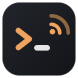
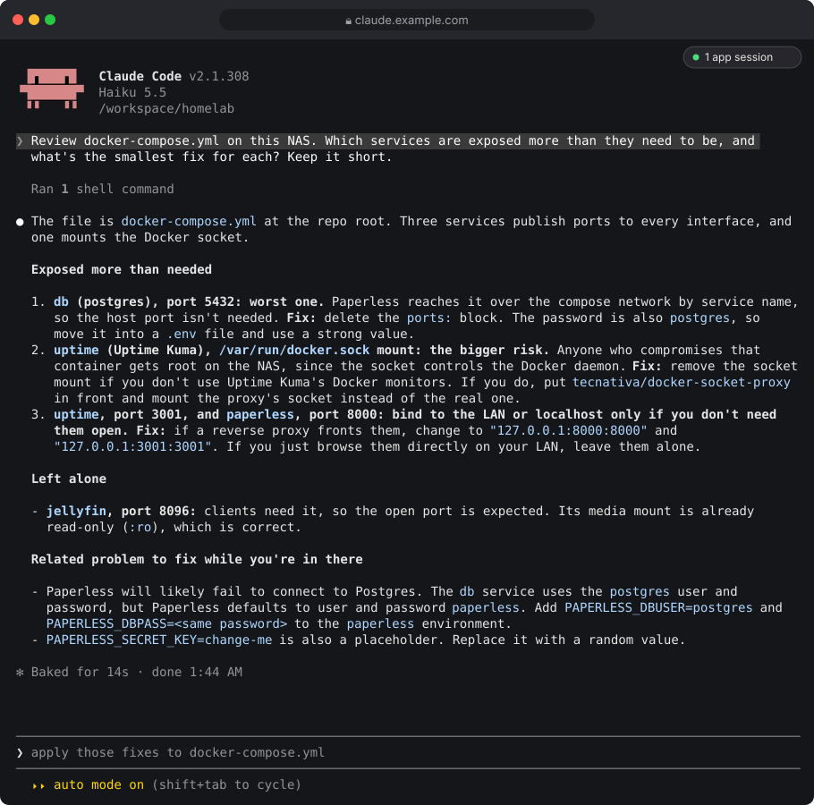

<p align="center"></p>

<h1 align="center">claude-code-remote-container</h1>

<p align="center"><b>Claude Code on your home server. In a browser tab, and in the Claude app.</b></p>

<p align="center">
<a href="https://github.com/cmmichael/claude-code-remote-container/actions/workflows/ci.yml"></a>
<a href="https://github.com/cmmichael/claude-code-remote-container/releases"></a>
<a href="LICENSE"></a>
</p>

A lightweight container for a NAS or any always-on box. It keeps Claude Code running next to your files and containers, opens it in any browser, connects it to the Claude app with Remote Control, and installs Claude Code updates while you're away.



## Who it's for

| You're on | Use |
| --- | --- |
| **A Mac or PC in front of you** | The Claude desktop app, or Claude Code in your own terminal. That's the better experience there, and you don't need this. |
| **A NAS or home server** (Synology, Unraid, TrueNAS, a Raspberry Pi, a mini PC) | **This.** Claude Code lives where your files and containers are, is always on, and you reach it from a browser or your phone. |

Mount the folder your configs live in, then ask. For example:

- **Your Docker stack:** "List every published port and Docker-socket mount in docker-compose.yaml, and say which you'd tighten."
- **Your proxy:** "Add a Pomerium route for jellyfin.example.com with the same policy as photos. Back up the config first."
- **A broken container**, with read-only Docker access: "paperless restarted 30 times today. Read its logs, find the cause, propose the smallest fix."
- **A Raspberry Pi:** "List Home Assistant automations that reference entities that no longer exist."

More prompts, and compose recipes for a Synology and a Raspberry Pi, are in [docs/use-cases.md](docs/use-cases.md).

## What you get

- **Persistent web terminal.** tmux behind [ttyd](https://github.com/tsl0922/ttyd). Close the tab or switch devices; the session keeps running and you reattach.
- **Built for the Claude app.** Remote Control is on. The terminal session appears in the Claude app and on claude.ai, and you can start new sessions from your phone. A badge in the terminal lists those app sessions.
- **Picks up where you were.** Restarts and rebuilds resume the same conversation by its id.
- **Updates without the button.** Claude Code downloads updates in the background. The container moves idle sessions onto a new release, after checking that the release runs.
- **Checks who you are.** Behind Pomerium or Tailscale, the container verifies the signed identity on every request, websockets included.
- **Server manners.** Runs as any UID/GID, stops cleanly, reports health, and copy and paste reach your clipboard.

## Quick start

```sh
git clone https://github.com/cmmichael/claude-code-remote-container && cd claude-code-remote-container
cp .env.example .env            # set PUID/PGID (owner of your files) and WORKSPACE_DIR
mkdir -p config workspace
sudo chown "$(id -u):$(id -g)" config workspace   # must match PUID/PGID
docker compose up -d
```

Open http://127.0.0.1:7681 on that machine. On first start:

1. Run `/login` with a claude.ai account. Remote Control needs one; API keys don't work for it.
2. Accept the trust prompt for `/workspace`.

The Remote Control server retries every 30 seconds and picks up the login by itself. Within a minute the session shows up in the Claude app.

`docker compose up -d` builds the image locally. To use the published image instead, see [Images and updates](#images-and-updates).

**Guides:** [Synology](docs/synology.md) · [Behind Pomerium](docs/pomerium.md) · [Behind Tailscale](docs/tailscale.md) · [Use cases and recipes](docs/use-cases.md) · [Monitoring, Watchtower, Traefik](docs/monitoring.md)

## Reaching it from elsewhere

The web terminal is a shell with your Claude login. The compose file publishes it on `127.0.0.1` only. To reach it from other devices, put an authenticating proxy in front, and turn on the container's own check (next section):

- **Pomerium**, identity-aware with your Google/GitHub/OIDC login: [docs/pomerium.md](docs/pomerium.md), example in `examples/pomerium/`.
- **Tailscale**, on your tailnet only: [docs/tailscale.md](docs/tailscale.md), example in `examples/tailscale/`.
- **Caddy with basic auth**: `examples/caddy.Caddyfile`. Or set `TTYD_CREDENTIAL=user:password` for ttyd's own basic auth, only over TLS.

The proxy must allow websockets.

## Allowed users

The proxy in front decides who reaches the container. The container can also check every request itself, websockets included, before anything reaches the terminal. That keeps the terminal closed to a request that gets to the container some other way: another container on the same network, a published port, or a proxy rule that's too broad.

| `CLAUDE_WEB_AUTH` | Who is the user | Configure |
| --- | --- | --- |
| `none` (default) | Nobody is checked | |
| `pomerium` | The `email` in Pomerium's signed `X-Pomerium-Jwt-Assertion`. The signature (ES256), expiry and audience are verified against Pomerium's keys | `CLAUDE_WEB_POMERIUM_JWKS_URL`, `CLAUDE_WEB_POMERIUM_AUDIENCE` (the route's host). Set `pass_identity_headers: true` on the route |
| `header` | A header set by a trusted proxy, `Tailscale-User-Login` by default. Believed only from `CLAUDE_WEB_TRUSTED_PROXIES` | `CLAUDE_WEB_AUTH_HEADER`, `CLAUDE_WEB_TRUSTED_PROXIES` (default `127.0.0.1/32,::1/128`) |

`CLAUDE_WEB_ALLOWED_USERS` lists who may in: exact addresses, `*@example.com` for a domain, or `*` for anyone the proxy authenticated. Empty means nobody. Everyone else gets 403, and the container log says who was refused and why, once a minute per user and reason.

- **Pomerium.** See [docs/pomerium.md](docs/pomerium.md) and `examples/pomerium/`. Point `CLAUDE_WEB_POMERIUM_JWKS_URL` at `https://<route host>/.well-known/pomerium/jwks.json`. The key URL is always configured, never taken from the request, so a forged Host header can't supply its own keys.
- **Tailscale.** See [docs/tailscale.md](docs/tailscale.md) and `examples/tailscale/`. A Tailscale sidecar serves the terminal on your tailnet with HTTPS, and the container shares its network, so Tailscale Serve is the only thing that can reach it on `127.0.0.1` and set `Tailscale-User-Login`.
- **Other proxies** that set a user header (oauth2-proxy's `X-Forwarded-Email`, Authelia's `Remote-User`) work with `header` mode. List the proxy's address in `CLAUDE_WEB_TRUSTED_PROXIES`, and make sure nothing else can reach port 7681.

### Check your setup

`/api/whoami` answers with who the container thinks you are. Open it through your proxy:

```sh
curl -s https://claude.example.com/api/whoami
# {"auth":"pomerium","user":"you@example.com"}
```

A refused request answers 403 with the reason, for example `audience other.example.com is not claude.example.com`, `request from 172.18.0.5, not a trusted proxy`, or `bob@example.com is not in CLAUDE_WEB_ALLOWED_USERS`. The container log has the same line. A request that skips the proxy should get 403 too: try `curl -s http://<container-ip>:7681/api/whoami` from another container on the same network.

## Copy and paste

tmux and Claude Code both hold the mouse, so a plain drag is tmux's selection, not the browser's. All of these land on your clipboard:

| To | Do |
| --- | --- |
| Copy what you drag | Drag with the mouse. tmux copies the selection when you let go. |
| Copy from Claude Code | Use its own copy keys, such as `c` on the `/login` screen. |
| Copy with the browser's own selection | Hold `Option` (macOS) or `Shift` (Windows, Linux) while dragging. Look for the brief ✂ icon. |
| Open the login URL | Click any row of it. It is a real link, so the whole URL opens even though it wraps. |
| Paste | `Cmd+V` or `Ctrl+Shift+V`, or `Shift+Insert`. |

The first two travel as OSC 52 escape sequences, and browsers accept those only on HTTPS or `localhost`. Behind a plain-HTTP proxy, use the modifier drag instead.

ttyd 1.7.7, the current release, embeds a web client that ignores OSC 52 entirely. The image therefore builds the newer ttyd client (xterm.js 5.5 with its clipboard addon) from a pinned commit and serves it with `--index`. `tmux.conf` labels every copy the way that client accepts and forwards hyperlinks, which needs the tmux 3.5 from bookworm-backports.

## Configuration

| Variable | Default | Meaning |
| --- | --- | --- |
| `PUID` / `PGID` | 1000 | User the container runs as; must own `./config` |
| `WORKSPACE_DIR` | `./workspace` | Host folder mounted at `/workspace` |
| `CLAUDE_RC_NAME` | `claude-web` | Session name in claude.ai/code |
| `TTYD_CREDENTIAL` | empty | Optional `user:password` for the web terminal |
| `TTYD_PORT` | 7681 | Host port, loopback only |
| `CLAUDE_AUTO_UPDATE_RESTART` | `true` | Run the update watcher |
| `CLAUDE_UPDATE_IDLE_SECS` | 900 | Idle time before an update restart |
| `CLAUDE_UPDATE_CHANNEL` | `stable` | Claude Code releases to follow: `stable`, typically about a week behind and skipping releases with major regressions, or `latest`. It sets the first install and Claude Code's own background updater (`autoUpdatesChannel`) |
| `CLAUDE_REMOTE_CONTROL_SERVER` | `true` | Run the separate Remote Control server |
| `CLAUDE_RC_PRECREATE_SESSION` | `false` | `true` makes the Remote Control server open an idle session in `/workspace` at start. Off by default, so the app and the sessions badge list only sessions someone started |
| `CLAUDE_RC_SERVER_NAME` | the hostname | Title of that pre-created session, when `CLAUDE_RC_PRECREATE_SESSION=true` |
| `CLAUDE_RC_PERMISSION_MODE` | Claude Code's default | Permission mode for sessions started from the app: `default`, `acceptEdits`, `plan`, ... |
| `CLAUDE_WEB_FRONT` | `true` | Serve the terminal through the front end that adds the app-sessions badge; `false` lets ttyd take port 7681 directly |
| `TTYD_INTERNAL_PORT` | 7683 | Loopback port ttyd uses behind the front end |
| `CLAUDE_WEB_AUTH` | `none` | Check who uses the web terminal: `none`, `pomerium` or `header` (see Allowed users) |
| `CLAUDE_WEB_ALLOWED_USERS` | empty | Who may use it: addresses, `*@domain`, or `*` |
| `CLAUDE_STOP_GRACE_SECS` | 20 | How long Claude gets to exit when the container stops. Keep it under `stop_grace_period` (30s) |

Build arguments `INSTALL_DOCKER_CLI` and `INSTALL_GH` (both `true`) control the optional Docker and GitHub CLIs. To let Claude manage containers, point `DOCKER_HOST` at a restricted socket proxy such as `tecnativa/docker-socket-proxy`. Don't mount the raw Docker socket: that is root on the host.

## App sessions

Sessions started from claude.ai/code or the Claude app run headless under the Remote Control server, so the web terminal can't show them. A badge in the terminal's top-right corner shows how many there are, with a pulsing dot while one is working. Click it for the list: each entry links to the session on claude.ai/code. Esc or a click elsewhere closes it. The badge stays hidden when there are none.

`scripts/web-front.js` provides it. It takes port 7681, proxies the terminal (websockets included) to ttyd on loopback, serves the list as JSON at `/api/sessions`, and adds `scripts/web-badge.html` to the terminal page. Busy and idle come from the session hook's per-process stamps. With `TTYD_CREDENTIAL` set, `/api/sessions` asks for the same credential.

## How it works

- `scripts/entrypoint.sh` installs Claude Code into `$HOME/.local/bin` if missing, adds two hooks to `$HOME/.claude/settings.json`, and starts tmux, ttyd, the watcher and the Remote Control server.
- `scripts/session.sh` runs inside tmux. It loops `claude --resume <id> --remote-control <name>`, falling back to `--continue`, then a fresh session.
- The hooks (UserPromptSubmit and Stop) record when a turn starts and ends and the current session id in `$HOME/.claude/autoupdate-state/`. They only act in the web-terminal session.
- `scripts/update-watcher.sh` checks every minute whether the running binary is older than the installed one. When no turn is in flight and the terminal has been quiet for the idle time, it sends SIGTERM, and the session loop resumes on the new version. A turn interrupted with Esc never records its end, so after an hour of quiet it stops counting. A permission question left unanswered that long looks the same: the restart drops it, and you ask again in the resumed conversation. Before restarting anything onto a release, it checks that the release answers `claude --version`. A release that fails is not moved onto, and it is checked again every 10 minutes, so a failure that passes, such as a timeout under load, does not strand the session.
- On `docker stop`, the entrypoint stops its restart loops, sends every Claude process SIGTERM and waits up to `CLAUDE_STOP_GRACE_SECS` before taking tmux down. Claude finishes cleanly and its Remote Control sessions close instead of being killed.
- Claude Code installs in the background on first start, so the web terminal is up at once. The session waits for the binary, and Ctrl-C there gives a shell.
- The image's health check calls `/healthz`, which answers 503 when the terminal is down, skips the user check and logs nothing. `/healthz?full=1` adds JSON detail for monitors: see [docs/monitoring.md](docs/monitoring.md).

## Compared with other projects

| | claude-code-remote-container | [HolyClaude](https://github.com/CoderLuii/HolyClaude) | [claudebox](https://github.com/RchGrav/claudebox) | [beevelop/docker-claude](https://github.com/beevelop/docker-claude) |
| --- | --- | --- | --- | --- |
| What it is | Claude Code on a server, in the browser and the Claude app | All-in-one AI workstation | Isolated dev sandbox with language profiles | Headless Remote Control server |
| Interface | Claude Code's own terminal UI in a browser tab | CloudCLI web app with its own account | Your local terminal | Claude app only |
| Claude app / Remote Control | Terminal session and new sessions | - | - | New sessions |
| Resumes your conversation | By session id | - | - | - |
| Applies Claude Code updates | When idle, after a run check | With image releases | On rebuild | - |
| Built-in access check | Pomerium assertion or trusted header | Web app login | Local only | - |

From each project's README, October 2026. For a full browser workstation with many AI tools, HolyClaude is the richer choice. For a per-project sandbox on your laptop, use claudebox. This project does one thing: Claude Code's own interface on a server, wired into the Claude app.

## What's private

Everything personal lives in `./config` (the container's `$HOME`): Claude credentials, transcripts and settings. It is gitignored. Never commit or share it.

## Images and updates

Every merge to `main` is a release, published for amd64 and arm64:

| Tag | Moves |
| --- | --- |
| `ghcr.io/cmmichael/claude-code-remote-container:latest` | with every release |
| `:0.2` (major.minor) | with patch releases of that minor version |
| `:0.2.0` | never |

To use it, replace `build: .` in `docker-compose.yml` with `image: ghcr.io/cmmichael/claude-code-remote-container:latest` (or a pinned tag). To apply new releases unattended, run [Watchtower](https://containrrr.dev/watchtower/) with `WATCHTOWER_TIMEOUT=30s`, so it gives the container's clean stop time to finish. Claude Code itself updates inside the container either way; the image only carries the terminal, the scripts and the tools around Claude.

A weekly rebuild picks up Debian security updates. Each image carries an SBOM and build provenance.

## SSH as an arbitrary user

The container runs as whatever `PUID` you choose, which has no entry in `/etc/passwd`. OpenSSH refuses to run without one. `ssh`, `scp`, `sftp`, `ssh-keygen` and `ssh-add` therefore go through `scripts/with-passwd.sh`, which uses nss_wrapper to supply an entry for that process only. Keys and `~/.ssh/config` live in `./config/.ssh` and persist.

## Development

- **CI** (`.github/workflows/ci.yml`) runs on every pull request and push to `main`. It lints the scripts (shellcheck), the Dockerfile (hadolint) and the workflows (actionlint), runs the web front end's unit tests (`node --test tests/*.test.js`, no Docker needed), then builds the image and runs `tests/smoke.sh` against it.
- **Smoke test.** `tests/smoke.sh` starts the image with a stand-in `claude`, so it needs no login or download. It checks health, the terminal page and badge, `/api/sessions`, a websocket session through the proxy, the hooks and channel in `settings.json`, SSH for an unknown uid, the update watcher, and a clean `docker stop`. Run it locally with `docker build -t claude-code-remote-container:ci . && tests/smoke.sh`.
- **Images** (`.github/workflows/image.yml`) publish to GHCR from `main`, from `v*` tags, weekly (so Debian security updates land), and on demand for any branch. Each image carries an SBOM and provenance attestation.
- **Pinning.** Base images are pinned by digest and actions by commit. Dependabot opens weekly grouped PRs to move them.
- **Releases.** Every merge to `main` is a release: the next semver tag, a GitHub Release whose notes are the merged PR's title and description, and the image just built tagged `:<x.y.z>` and `:<x.y>`. It is a patch release by default. Label the PR `release:minor` or `release:major` to bump further, or `release:skip` for changes that ship nothing, such as docs or CI. Pin a host to a release with `ghcr.io/<owner>/claude-code-remote-container:<x.y.z>`, or check out the tag and build it.

## Licence

MIT, see [LICENSE](LICENSE) and [THIRD_PARTY_NOTICES.md](THIRD_PARTY_NOTICES.md).

An independent community project, not affiliated with or endorsed by Anthropic. Claude and Claude Code are trademarks of Anthropic. The container installs Claude Code with Anthropic's official installer, under Anthropic's terms.
